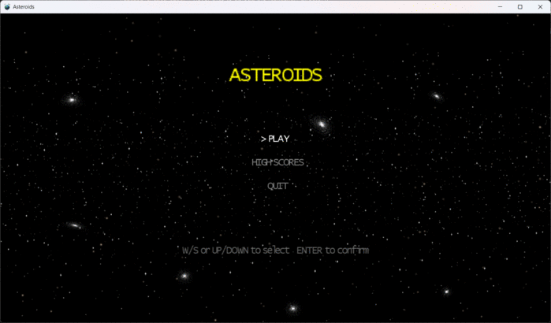

# Asteroids

A 3D Asteroids game built with MonoGame 3.8.1 / .NET 9, migrated from the original XNA 4.0 / .NET Framework 4.0 codebase.




## Gameplay

- Pilot your ship through an asteroid field and shoot them down before they hit you
- Shoot a large asteroid and it breaks into 3 medium fragments; a medium breaks into 2 small ones
- Asteroids bounce off each other and deal crack damage — enough hits and they shatter
- Difficulty ramps up over time: the field starts sparse and slow, then fills to full speed
- You lose a life when an asteroid hits your ship; game over when all lives are lost
- High scores are saved between sessions

### Controls

| Action | Keyboard | Gamepad |
|---|---|---|
| Thrust | `W` / `↑` | Right Trigger |
| Rotate Left | `A` / `←` | Left Stick |
| Rotate Right | `D` / `→` | Left Stick |
| Fire | `Space` | `A` |
| Warp to Center | `Home` | `Start` |
| Quit | `Escape` | `Back` |

### Scoring

| Event | Points |
|---|---|
| Destroy large asteroid | +10 |
| Destroy medium asteroid | +25 |
| Destroy small asteroid | +50 |
| Fire a shot | −1 |
| Ship destroyed | −100 |
| Warp | −50 |

## Requirements

- [.NET 9 SDK](https://dotnet.microsoft.com/download/dotnet/9)
- Windows, macOS, or Linux

## Building & Running

**Windows** (DirectX 11):
```bash
dotnet run --project Asteroids/Asteroids.csproj
```

**macOS / Linux** (OpenGL via DesktopGL):
```bash
dotnet run --project Asteroids/Asteroids.GL.csproj
```

The MonoGame content pipeline runs automatically as part of the build via `MonoGame.Content.Builder.Task`.

## Tests

```bash
dotnet test Asteroids.Tests/Asteroids.Tests.csproj
```

37 xUnit tests across five suites:

| Suite | What it covers |
|---|---|
| `HighScoreManagerTests` | Save/load round-trip, tamper detection, sort order, capacity |
| `GameConstantsTests` | Size ranks, fragment counts, speed/difficulty invariants, ship max speed, spawn immunity duration |
| `AsteroidUpdateTests` | Position advance, playfield wrap, spawn immunity timer countdown |
| `CollisionGeometryTests` | Asteroid-asteroid, bullet-asteroid, ship-asteroid bounding sphere detection |
| `RenderLayerTests` | Particle draw order invariants, depth stencil state configuration |

## Releases

Pre-built binaries for all platforms are available on the [Releases page](../../releases):

| Platform | File | Notes |
|---|---|---|
| Windows (installer, lite) | `Asteroids_Setup_*_lite.exe` | Requires .NET 9 runtime |
| Windows (installer, full) | `Asteroids_Setup_*_full.exe` | Self-contained, no runtime needed |
| Windows (portable zip) | `Asteroids_*_win-x64_portable.zip` | Self-contained, just unzip and run |
| macOS arm64 | `Asteroids_*_osx-arm64.zip` | Apple Silicon |
| macOS x64 | `Asteroids_*_osx-x64.zip` | Intel Mac |
| Linux x64 | `Asteroids_*_linux-x64.tar.gz` | Self-contained |

### Windows

Run the installer (`.exe`) or unzip the portable archive and double-click `Asteroids.exe`.

### macOS

```bash
unzip Asteroids_*_osx-arm64.zip   # or osx-x64.zip on Intel
chmod +x Asteroids
./Asteroids
```

### Linux

```bash
# Install SDL2 if not already present
sudo apt install libsdl2-2.0-0

tar -xzf Asteroids_*_linux-x64.tar.gz
chmod +x Asteroids
./Asteroids
```

## Building release packages (manual)

### Windows

```bash
# Framework-dependent (requires .NET 9 runtime)
dotnet publish Asteroids/Asteroids.csproj /p:PublishProfile=win-x64

# Self-contained
dotnet publish Asteroids/Asteroids.csproj /p:PublishProfile=win-x64-full
```

To produce an installer, install [Inno Setup 6](https://jrsoftware.org/isdl.php) and compile `installer/Asteroids.iss`. For a self-contained installer pass `/DFull=1`.

### macOS

```bash
dotnet publish Asteroids/Asteroids.GL.csproj /p:PublishProfile=osx-arm64   # Apple Silicon
dotnet publish Asteroids/Asteroids.GL.csproj /p:PublishProfile=osx-x64     # Intel
```

### Linux

```bash
dotnet publish Asteroids/Asteroids.GL.csproj /p:PublishProfile=linux-x64
```

Output lands in `Asteroids/publish/<profile>/`.

## Project Structure

```
.github/workflows/      # CI (build + test on push/PR) and release pipeline
Asteroids/              # Game source (.cs), publish profiles
  Asteroids.csproj      # WindowsDX build (Windows, DirectX 11)
  Asteroids.GL.csproj   # DesktopGL build (macOS / Linux, OpenGL)
AsteroidsContent/       # Game assets (models, textures, audio, shaders)
Asteroids.Tests/        # xUnit test project
fbxconvert/             # Utility: FBX 6.0 → DirectX .x format
installer/              # Inno Setup script for the Windows installer
```

## Tech Notes

- **XNA → MonoGame**: Migrated from XNA 4.0 to MonoGame 3.8.1.303; two backends — `WindowsDX` (DirectX 11, Windows) and `DesktopGL` (OpenGL/SDL2, macOS/Linux)
- **Model format**: Original FBX 6.0 files are too old for Assimp; a custom converter (`fbxconvert/`) converts them to DirectX `.x` ASCII format
- **Coordinate system**: FBX uses right-handed coordinates; the converter negates Z and reverses triangle winding to match XNA/DirectX left-handed conventions
- **Particle system**: GPU-driven particles using a circular vertex buffer; uses `HalfVector2` for corner offsets (required for DX11 — `Short2` is an integer format and cannot be read as `float2` in HLSL)
- **Shader**: `ParticleEffect.fx` compiled to `vs_4_0_level_9_1` / `ps_4_0_level_9_1`
- **High scores**: `highscores.dat` is AES-256-CBC encrypted with a fresh IV per save; an HMAC-SHA256 over IV + ciphertext is stored in the file header — any modification is detected and the file is discarded
- **GL / DX visual parity**: additive blend strength and MSAA are tuned per backend via `DESKTOPGL` compile symbol (`GameConstants.cs`); OpenGL's linear color space makes additive blending stronger, so the star boost factor is lower on GL
- **Constants**: All magic numbers and string literals live in `GameConstants.cs` — see `CLAUDE.md` for the enforcement rule
